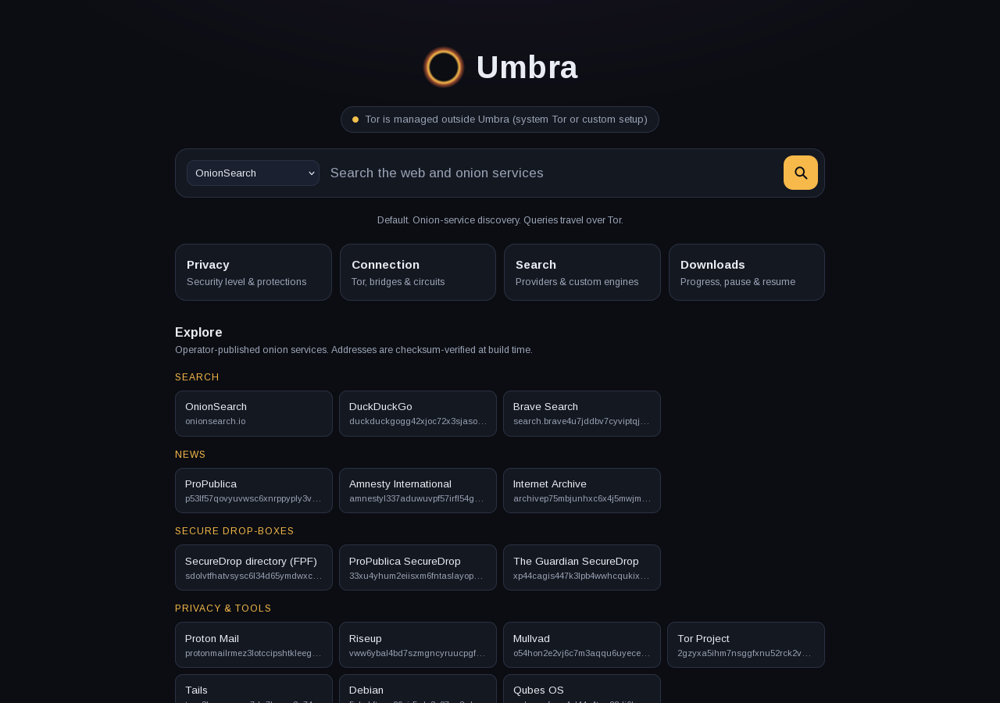

<p align="center">
  
</p>

<h1 align="center">Umbra</h1>

<p align="center">
  <b>A privacy-first browser built on Tor Browser, with OnionSearch as its default search engine and its own identity, search ecosystem and onion explorer.</b>
</p>

<p align="center">
  <a href="https://github.com/FAHTHIZ/Umbra/actions/workflows/ci.yml"></a>
  <a href="LICENSE"></a>
  
</p>

<p align="center"></p>

> **Honest status.** Umbra 0.1 is a real, working browser for **Linux x86-64**. Windows, macOS and Android are on the [roadmap](docs/ROADMAP.md). Tor reduces what networks and websites can learn about you. **It doesn't guarantee anonymity.** Read the [threat model](docs/THREAT_MODEL.md).

## Why Umbra

- **Tor at the core, not an add-on.** Umbra uses the same engine, bundled `tor`, bridges, circuit isolation and anti-fingerprinting as the official Tor Browser. [Why we chose this foundation](docs/FOUNDATION_DECISION.md).
- **Search ecosystem.** OnionSearch.io is the default. DuckDuckGo, Brave Search, Startpage (each also available as an onion service), Ecosia, Google, Mojeek, Wikipedia and your own custom engines are one click away. Every provider is reached through Tor.
- **Umbra Explore.** A curated directory of operator-published onion services. Every address is v3-checksum-verified in CI, so typos and lookalikes can't slip in.
- **Same fingerprint as Tor Browser.** Umbra changes nothing a website can observe. A test compares 500+ security preferences against upstream on every build.
- **Verified supply chain.** Every build checks the upstream OpenPGP signature against a pinned key **and** a pinned SHA-256, then produces deterministic output.
- **No telemetry.** Umbra's own pages make zero network requests.

## Install (Linux x86-64)

```bash
# 1. Download the latest release and its checksum file
#    https://github.com/FAHTHIZ/Umbra/releases
sha256sum -c SHA256SUMS
tar xf umbra-*-linux-x86_64.tar.xz
cd umbra
./start-umbra.desktop            # launch
./start-umbra.desktop --register-app   # optional: add Umbra to your app menu
```

On first launch, Umbra opens the Tor connection screen. Click **Connect**, or configure bridges if Tor is blocked where you are. More options are in [docs/INSTALL.md](docs/INSTALL.md).

## Build from source

```bash
git clone https://github.com/FAHTHIZ/Umbra && cd Umbra
pip install -r requirements-dev.txt
python -m tools.umbra_build build      # fetch + verify upstream, apply overlay, package
ls dist/                               # umbra-<ver>-linux-x86_64.tar.xz, SHA256SUMS
```

A build takes about 20 seconds after the roughly 150 MB upstream download. Details: [docs/BUILDING.md](docs/BUILDING.md).

## Test

```bash
python -m pytest tests/unit            # fast, no browser
python -m pytest tests/integration     # real headless browser: search, branding, home, parity vs upstream
python -m pytest tests/leak            # DNS / direct-connection / fail-closed / circuit-isolation leak tests
UMBRA_LIVE_TOR=1 python -m pytest tests/live   # needs Tor network access
python bench/benchmark.py --runs 10    # Umbra vs upstream on the same machine
```

Integration and leak tests need [geckodriver](https://github.com/mozilla/geckodriver/releases) on `PATH`. See [docs/TESTING.md](docs/TESTING.md).

## What's implemented

| Area | Status |
|---|---|
| Browser (tabs, history, bookmarks, downloads, media, fullscreen, passwords, extensions) | Provided by the Tor Browser engine |
| Umbra home page, branding, provider switcher | ✅ tested |
| Umbra Access Engine (local page inspection; opt-in ad/tracker + cosmetic filtering) | 🧪 packaged; browser smoke tests added, onion tests pending |
| OnionSearch default + 12 providers + custom engines | ✅ tested |
| Umbra Explore (curated onions, checksum-verified) | ✅ tested |
| Tor routing, remote DNS, fail-closed, per-site circuits | ✅ leak-tested |
| Fingerprint parity with Tor Browser | ✅ tested |
| Umbra Privacy dashboard, Vault export, Desk, Source, Assistant | 📋 planned |
| Windows / macOS / Android | 📋 planned |

The full, honest list is in [docs/CHECKLIST.md](docs/CHECKLIST.md).

## Performance

Measured against unmodified Tor Browser 16.0.1 on the same machine ([details](docs/PERFORMANCE.md)):

| | Umbra 0.1 | Tor Browser |
|---|---|---|
| Cold start to home page | 817 ms | 817 ms |
| Memory (home page open) | 731 MB | 737 MB |
| Home page load | **44 ms** | 99 ms |

## Repository map

```
upstream/      pinned Tor Browser release (version, sha256, signing key)
tools/         umbra_build pipeline, upstream bump, Explore generator
overlay/       everything Umbra adds: search, home, explore, prefs, patches, access engine
tests/         unit · integration · leak · live
bench/         benchmark harness + recorded results
docs/          architecture, threat model, security, roadmap, checklist, ideas
android/       Android plan (source track)
```

## Contributing

Contributions are welcome. Start with [CONTRIBUTING.md](CONTRIBUTING.md). The three hard rules:

1. Never change anything a website can observe. The parity test enforces this.
2. Never add network requests to Umbra's own pages.
3. Never mark a feature as done without a test.

Security issues: please follow [SECURITY.md](SECURITY.md). Don't file them as public issues.

## Credits & license

Umbra is built on [Tor Browser](https://gitlab.torproject.org/tpo/applications/tor-browser) by The Tor Project and on Mozilla Firefox. Umbra is an independent project, **not affiliated with or endorsed by The Tor Project**. "Tor" is a registered trademark of The Tor Project, Inc.

Umbra's own code is licensed under [MPL-2.0](LICENSE). Upstream components keep their own licenses.
