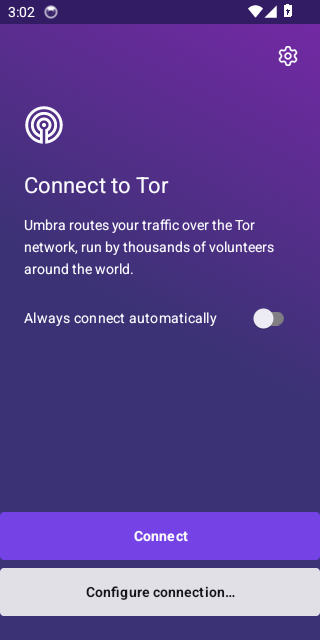
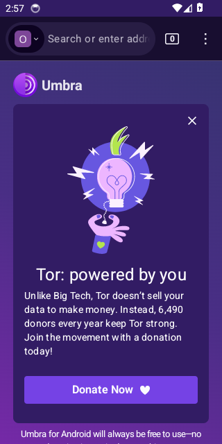
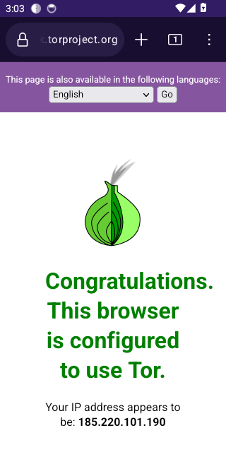
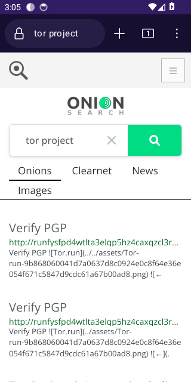

# Umbra for Android

Umbra for Android is the official **Tor Browser for Android** (Fenix + GeckoView + bundled tor), rebranded and re-signed. It looks and works like a normal mobile browser: address bar, tabs, bookmarks, history (off by default), downloads, reader view, private tabs and settings. Tor runs inside the app, so there's nothing else to install.

<p align="center">




</p>
<p align="center"><sub>Screenshots from the CI emulator run: connect, home, check.torproject.org, default search.</sub></p>

## Install

1. Download `umbra-<version>-android-aarch64.apk` from [Releases](https://github.com/FAHTHIZ/Umbra/releases). Almost every phone made since 2017 is aarch64 (arm64). Use `armv7` for old 32-bit phones and `x86_64` for emulators and Chromebooks.
2. Check it: `sha256sum -c --ignore-missing SHA256SUMS`, and optionally `apksigner verify --print-certs umbra-*.apk`. The signing certificate SHA-256 digest must be:

   ```
   eea28ca897b00d4b65f187124993c55614136968fa09e2efb77922525758645b
   ```
3. Open the APK on the phone and allow "Install unknown apps" for your browser or file manager.
4. Open **Umbra** and tap **Connect**. If Tor is blocked where you are, choose a bridge (Snowflake works in most places).

Umbra installs as `org.umbra.browser`, so it sits next to Tor Browser instead of replacing it. Android requires Android 8.0 (API 26) or newer.

## What's different from Tor Browser for Android

| | Umbra | Tor Browser |
|---|---|---|
| Engine, tor, bridges, security levels, anti-fingerprinting | identical (copied byte-for-byte, except the `libz.so` dependency name in `libTor.so`, see below) | — |
| Default search | OnionSearch | DuckDuckGo |
| Search providers | OnionSearch, DuckDuckGo (+ no-AI, + onion), Brave (+ onion), Startpage (+ onion), Ecosia, Google, Mojeek, Wikipedia | DuckDuckGo (+ onion), Startpage (+ onion), Wikipedia |
| App id / name / icon | `org.umbra.browser`, Umbra, eclipse mark | `org.torproject.torbrowser` |
| Signing key | Umbra release key (above) | The Tor Project |

Websites see exactly what they would see from Tor Browser for Android, because the engine and its preferences aren't modified.

## How it's built

`python -m tools.umbra_build build --platform android-aarch64` (or `android-armv7`, `android-x86_64`):

1. Downloads the pinned Tor Browser APK and checks its **SHA-256** and **OpenPGP signature** against the pinned Tor Browser key (`upstream/tor-browser.lock.json`). A mismatch stops the build.
2. Decodes resources and the manifest with a pinned apktool (SHA-256-checked). Dex code, native libraries (`libxul.so`, `libTor.so`, pluggable transports) and the GeckoView `omni.ja` are not decoded and are copied unchanged, with one exception: upstream 16.0.1's `libTor.so` asks the dynamic linker for `libz.so.1`, which no Android release provides (Android ships zlib as `libz.so`), so the tor process can't start. The build rewrites that one dependency name in place (2 bytes in `.dynstr`; code is untouched) and records the before/after hashes in the build report, along with the `omni.ja` hash.
3. Applies the overlay: application id, provider authorities and permissions; the app name in every locale; launcher icons; search engines generated from `overlay/search/umbra-search-engines.json`, the same file the desktop build uses.
4. Rebuilds with aapt2, zipaligns and signs with APK Signature Scheme v2 + v3.

Without `UMBRA_ANDROID_KEYSTORE` / `UMBRA_ANDROID_KEYSTORE_B64` + `UMBRA_ANDROID_KEYSTORE_PASS`, the build signs with a throwaway key and names the file `*-testsigned.apk`. The release workflow refuses to publish those.

Needs Java 11+, `zipalign` and `apksigner` (Android build-tools, or the Debian `zipalign` and `apksigner` packages).

## Testing

- `tests/unit/test_android.py`: manifest, search, branding and icon transformations.
- `tests/android/smoke.py`: runs on an emulator in CI (`android` job). It installs the APK, launches it, checks the process stays up with no crash, checks the launcher label, taps **Connect**, waits for tor's `Bootstrapped 100%`, types `https://check.torproject.org/` into the address bar and checks for "Congratulations. This browser is configured to use Tor.", then searches from the address bar and checks that OnionSearch answers. Screenshots are uploaded as the `umbra-android` artifact.

## Limits

- **Updates.** Umbra for Android doesn't update itself yet. Install a newer APK over the old one; Android keeps your data because the signing key stays the same.
- **Umbra modules.** The desktop Umbra pages (Privacy, Desk, Vault, Source, Investigate, Assistant, Explore home) aren't on Android yet. The native Fenix home screen is used.
- **Store listing.** Umbra isn't on Google Play or F-Droid yet.
